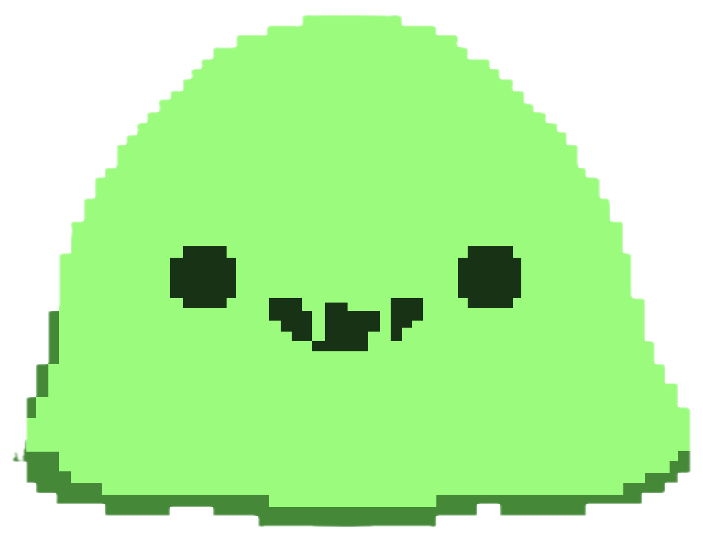

<p align="center">
  
</p>

<h1 align="center">Gooey</h1>

<p align="center">
  A Vue 3 component library built on Tailwind CSS, Reka UI, and shadcn-vue.
</p>

## Documentation

Full documentation, installation guide, and component examples are available at:

**[codinglabsau.github.io/gooey](https://codinglabsau.github.io/gooey/)**

## Installation

```bash
npm install @codinglabsau/gooey
```

See the [installation guide](https://codinglabsau.github.io/gooey/installation) for full setup instructions including Tailwind CSS configuration.

### Inertia v3 and Laravel

Toasts flashed from Laravel show through the optional `@codinglabsau/gooey/inertia` entry and its Laravel companion package:

```bash
npm install @inertiajs/vue3@^3
composer require codinglabsau/gooey
```

Mount `<InertiaFlasher />` from `@codinglabsau/gooey/inertia` in your layout, in place of any `<Flasher>` fed from shared `info`/`success`/`warning`/`error` props (keeping both shows each message twice). Existing `back()->with('success', 'Saved')` flashes then show as toasts, and `back()->toast(...)` or `Toast::success(...)->flash()` flash them directly. See the [Inertia Flasher docs](https://codinglabsau.github.io/gooey/components/inertia-flasher).

## Features

- 60+ ready-to-use Vue 3 components
- Built on Reka UI (formerly Radix Vue) primitives
- Tailwind CSS v4 support
- Dark mode support
- TypeScript-first
- Accessible by default

## Development

```bash
# Install dependencies
npm install

# Run docs site locally
npm run dev

# Build library
npm run build

# Run tests
npm run test

# Laravel package: install, test, format
composer install
composer test
composer format
```

## Changelog

See [CHANGELOG](CHANGELOG.md) for release history.

## Security

If you discover any security related issues, create an issue on GitHub.

## Credits

- [Steve Thomas](https://github.com/stevethomas)
- [All Contributors](../../contributors)

## License

MIT

## About Coding Labs

Coding Labs is a web app development agency based on the Gold Coast, Australia. See our open source projects [on our website](https://codinglabs.com.au/open-source).
